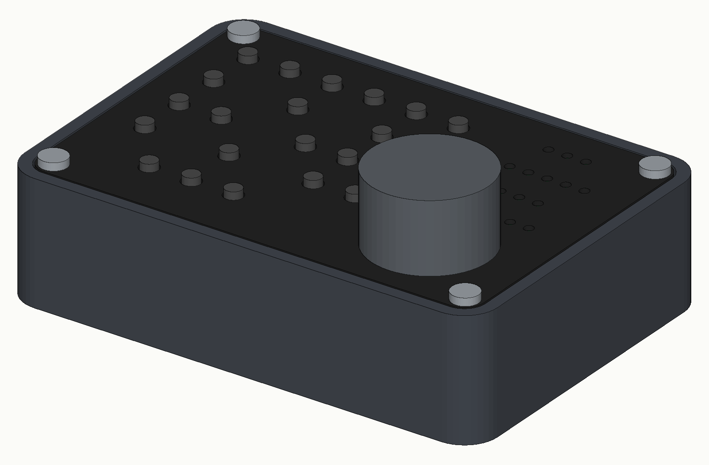

# CNC Pendant for UGS / GRBL (RP2040, USB keyboard)

> 🇨🇿 **Česky:** kompletní návod krok za krokem je v [`NAVOD.html`](NAVOD.html) / [`NAVOD.pdf`](NAVOD.pdf).

A handheld jog pendant for small GRBL CNC machines (built for a **Lunyee/3018 Pro Ultra**) controlled from
**Universal Gcode Sender (UGS Platform)**. The pendant is a USB HID keyboard based on an RP2040 board: it presses
F13–F24 shortcuts (with Shift / Ctrl / Ctrl+Shift) that are bound to UGS actions. No drivers, no plugins,
no changes to GRBL.

Everything is designed to be made at home on a 3018-class machine: PCB isolation milling, an MDF registration jig,
an aluminium front panel engraved with a diode laser, and a 3D-printed enclosure.

## Features

- 21 buttons (3×7 diode matrix): axis select X/Y/Z, jog X±/Y±/Z±, F+/F−, START, HOLD, STOP, UNLOCK,
  HOME, return-to-zero, probe Z, zero X/Y/Z
- EC11 rotary encoder: jog the selected axis; **fast spinning temporarily increases the step**;
  with no axis selected it changes the jog feed; push = bigger/smaller step
- 19 LEDs via 3× 74HC595: selected axis, XY step (0.05 / 0.1 / 1 / 10 / 50 / 100 mm),
  Z step (0.05 / 0.1 / 1 / 10 mm), jog feed (10 / 100 / 1k / 2k / 3k / MAX mm/min)
- Step and feed are set in UGS **absolutely**, so the LEDs always match UGS
- Safety: START, HOME, RTZ, PROBE and ZERO require a **0.5 s hold**; axis must be selected (locked otherwise);
  STOP and HOLD jump the key queue and discard pending jog steps
- Tap = one step, hold = continuous jog, **X + Y pressed together = diagonal jog**
- LEDs dim after 2 minutes idle (PWM on 595 OE); built-in **test mode** (hold STOP while plugging in)

## Hardware

| Board | Layers | Contents |
|---|---|---|
| **A – top** | double-sided | 21 switches 6×6 mm, 21× 1N4148W, 3× 74HC595 (SOIC-16) |
| **B – bottom** | single-sided | Laskakit Ultimate Pi Pico (RP2040), EC11E encoder, column pull-ups/filters |
| **C – LED** | single-sided, no jumpers | 19× LED 0603, 4 group resistors |

Panel 95 × 65 mm, M3 mounting holes on an 88 × 58 mm grid. Full BOM: [`08_soupiska_BOM/BOM_CNC_pendant.csv`](08_soupiska_BOM/BOM_CNC_pendant.csv).

### RP2040 pin map

| Function | GPIO |
|---|---|
| Matrix rows ROW0–2 | GP2, GP3, GP4 |
| Matrix columns COL0–6 | GP5 … GP11 (internal pull-up + 10k on board B) |
| Encoder SW / B / A | GP13 / GP14 / GP15 |
| 74HC595 SER / SRCLK / RCLK / OE | GP18 / GP19 / GP20 / GP21 (OE = PWM brightness) |

## Repository layout

| Folder | Contents |
|---|---|
| `00_obrazky` | renders, PCB layout images |
| `01_DPS_KiCad` | KiCad 10 projects of boards A, B, C (+ custom footprints, iBOM) |
| `02_DPS_frezovani` | FlatCAM G-code in machining order (A1–A6, B1–B4, C1–C3), Gerbers, FlatCAM projects, Candle height maps |
| `03_pripravek_MDF` | MDF registration jig (DXF + Fusion G-code), 4 × Ø2.5 mm pins on 88 × 58 mm |
| `04_panel_cela` | aluminium panel: milling (Fusion G-code), laser (SVG all-in-one, LightBurn project, power/speed test), DXF |
| `05_krabicka_3D_tisk` | enclosure (STEP – slicers open it directly), OpenSCAD + Fusion script, hex standoffs, knob |
| `06_firmware_Arduino` | `cnc_pendant_v11` (recommended), `cnc_pendant` v10, test sketches |
| `07_UGS_zkratky` | 34 UGS keymap files (`.shadow`) |
| `08_soupiska_BOM` | BOM, LED resistor calculation |

## Quick start

1. **Build the boards** – see `02_DPS_frezovani` and the guide. Boards are *not* plated: every via gets a wire and every
   THT pin that has a top trace must be soldered **on both sides**.
2. **Firmware** – Arduino IDE 2, board package *Raspberry Pi Pico/RP2040* by Earle Philhower
   (`https://github.com/earlephilhower/arduino-pico/releases/download/global/package_rp2040_index.json`),
   board *Raspberry Pi Pico*, USB Stack *Pico SDK*. Flash `06_firmware_Arduino/cnc_pendant_v11`.
   Test sketches first: `pendant_led_test`, `pendant_test` (types button names into Notepad).
3. **UGS shortcuts** – close UGS, copy all files from `07_UGS_zkratky/NetBeans/` to
   `%APPDATA%\ugsplatform\config\Keymaps\NetBeans\` (on Linux/macOS use the same `config/Keymaps/NetBeans` folder inside the UGS user directory),
   start UGS, check *Tools → Options → Keymap* (search `F13` → *Jog X+*). Enable *separate step size for Z*.
4. **Use it** – the UGS window must be focused (it is a keyboard). 2.5 s after plugging in, the pendant sets
   XY step 10 mm, Z step 1 mm, feed 1000 mm/min.

### Shortcut map

| Key | UGS action | Key | UGS action |
|---|---|---|---|
| F13/F14 | Jog X+/X− | Shift+F13/14/15 | Zero X/Y/Z |
| F15/F16 | Jog Y+/Y− | Shift+F16 | Probe Z |
| F17/F18 | Jog Z+/Z− | Shift+F17/F18 | Home / Return to zero |
| F21 | Pause/Resume | Shift+F19/F20/F21 | Jog feed ×10 / ÷10 / +1000 |
| F22/F23 | Start/Stop | Ctrl+F13…F16 | XY step 0.01/0.1/1/10 |
| F24 | Unlock | Ctrl+F17/F18 | XY step ×10 / + |
| Ctrl+Shift+F13…F16 | Diagonal X+Y+ / X+Y− / X−Y+ / X−Y− | Ctrl+F19…F22, F23 | Z step 0.01/0.1/1/10, Z + |

Other senders: anything that lets you bind keyboard shortcuts can use the pendant – only the keymap changes.

## Status

- Board A with all 21 buttons and 19 LEDs tested on hardware; UGS keymap tested; laser panel tested.
- Firmware **v11** passed host simulation but is **not yet tested on hardware** – v10 is the fallback.
- 3D-printed standoffs and knob not yet test-printed.

Issues, photos of your builds and improvements are welcome.

## How it was made

Designed and built by me with the help of an AI assistant (Claude) for the schematics, firmware and documentation. Everything was manufactured and tested on real hardware.

## License

- Hardware, mechanical parts, G-code and documentation: **CC BY-SA 4.0** – see [`LICENSE`](LICENSE)
- Firmware (`06_firmware_Arduino`): **MIT** – see [`06_firmware_Arduino/LICENSE`](06_firmware_Arduino/LICENSE)

© 2026 David Sládek
